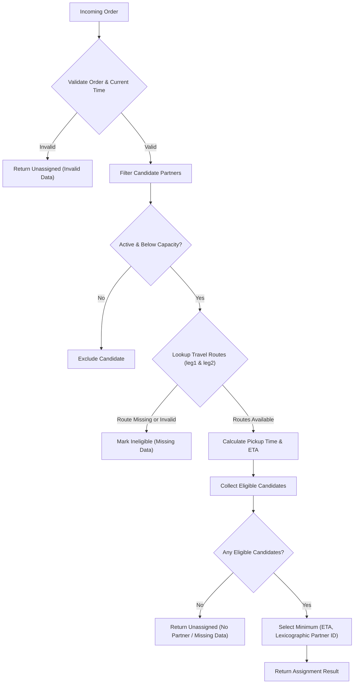

# Architecture Notes — SmartDispatch

## Project map
- `service.py`: Core dispatch engine exposing `estimate_eta`, `assign_order`, `process_cancellation`, and `batch_assign_orders`.
- `models.py`: Domain entity factory functions (`new_order`, `new_partner`).
- `fixtures.py` & `main.py`: Offline sample inputs and entry point demonstration.
- `data/records.json`: Synthetic dataset containing 180 orders, 60 partners, 387 travel routes, and 177 cancellation events.
- `tests/`: Automated test suite (`test_acceptance_matrix.py`, `test_contract.py`, `test_edge_cases.py`, and `test_regression.py`).

## Data model
- **Order:**
  - `order_id`: Non-empty string identifier.
  - `restaurant_id`: Non-empty string identifier of the merchant location.
  - `destination_zone`: Non-empty string identifier of the customer drop-off area.
  - `prep_minutes`: Non-negative finite numeric preparation time ($m \ge 0$).
- **Delivery Partner:**
  - `partner_id`: Unique identifier string.
  - `zone`: Current geographical zone identifier.
  - `active`: Boolean availability flag (strictly `True` to receive orders).
  - `capacity`: Maximum simultaneous orders allowed (integer $\ge 1$).
  - `active_order_ids`: List of in-flight order IDs assigned to this partner.
  - `workload_minutes`: Estimated minutes of remaining committed delivery workload.
  - `minutes_by_order`: Map of `order_id -> assigned_duration_minutes`.
  - `processed_cancellation_ids`: List of idempotently processed cancellation event IDs.
- **Travel Map:**
  - Mapping of `(origin_zone, destination_zone) -> minutes` where minutes is a non-negative finite number.

## Data flow
1. **Order Ingestion:** `assign_order` receives an order record, partner list, travel map, and current timestamp `now`.
2. **Validation:** Validates order IDs, non-negative prep time, and current time.
3. **Candidate Screening:**
   - Filters out partners that are inactive (`active is not True`).
   - Filters out partners with invalid capacity or at full capacity (`len(active_order_ids) >= capacity`).
4. **ETA Calculation (`estimate_eta`):**
   - Looks up partner-to-restaurant leg (`leg1`) and restaurant-to-customer leg (`leg2`).
   - If either leg is missing or invalid, candidate is marked ineligible.
   - Computes:
     - $\text{pickup} = \text{now} + \text{leg1} + \text{workload}$
     - $\text{eta} = \text{pickup} + \text{prep} + \text{leg2}$
5. **Selection & Tie-Breaking:** Selects candidate minimizing `(eta_minutes, str(partner_id))`.
6. **Cancellation Processing:** `process_cancellation` deduplicates by `event_id`, updates active orders, and decrements workload clamped at 0.

## Storage design
- In-memory dictionaries and tuple-keyed hash maps for high-performance sub-50 microsecond evaluations.
- Immutability patterns in `process_cancellation` and `batch_assign_orders` via deep copying to prevent shared mutable state bugs.

## Diagram

## Three improvements suggested
1. **Spatial Indexing for City-Scale Fleets:** Implement an $R$-tree or H3 hexagonal spatial index to partition partners geographically, avoiding linear scanning across tens of thousands of city partners.
2. **Dynamic Workload Decay:** Support timestamp-based automated workload decay based on elapsed time between dispatch events, reflecting real-world delivery progress.
3. **Distributed Deduplication Layer:** Back `processed_cancellation_ids` with a distributed cache (e.g. Redis with TTL) or persistent idempotency store to prevent duplicate cancellations across multi-region microservices.

