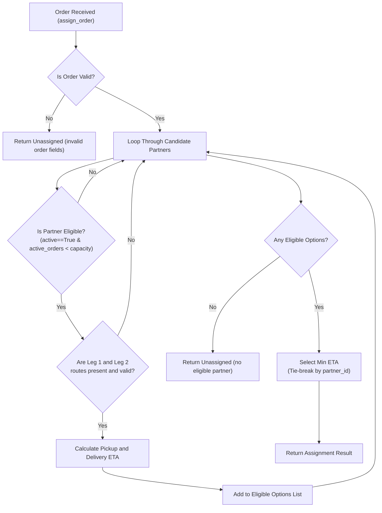

# Architecture Notes

## Project map

Here is how the project files are organized and how they connect with each other:

- **`service.py`**: The heart of the project. It contains the core decision logic:
  - `estimate_eta()`: Calculates pickup time and total delivery ETA for a single partner and order.
  - `assign_order()`: Filters active and capable partners, runs ETA estimation for each, and picks the partner with the lowest ETA (with tie-breaking).
  - `process_cancellation()`: Safely cancels an order, updates workload, and records event IDs idempotently.
- **`models.py`**: Helper factory functions (`new_order()` and `new_partner()`) that return dictionaries representing orders and delivery partners.
- **`fixtures.py`**: Provides sample inputs (`sample_inputs()`) with an order `O-7`, two partners `P-1` and `P-2`, and a small travel time dictionary.
- **`main.py`**: A small script to run an offline demo of the assignment logic and print the output dictionary to the console.
- **`data/records.json`**: An expanded synthetic dataset containing 180 orders, 60 partners, 387 travel time routes, and 177 cancellation events.
- **`tests/`**: The automated test suite:
  - `test_contract.py`: Basic contract and sanity checks.
  - `test_acceptance_matrix.py`: 170 parametrized boundary and type validation checks.
  - `test_edge_cases.py`: Extended ETA formula tests.
  - `test_regressions.py`: 71 regression tests I wrote to lock in our fixes.

---

## Data model

The project represents data using native Python dictionaries:

1. **Order Model (`dict`)**:
   - `order_id` (`str`): Unique identifier for the order (e.g. `'O-7'`).
   - `restaurant_id` (`str`): Identifier for the pickup location (e.g. `'R-2'`).
   - `destination_zone` (`str`): Delivery drop-off zone (e.g. `'Z-9'`).
   - `prep_minutes` (`int` or `float`): Estimated food preparation time (must be $\ge 0$).

2. **Delivery Partner Model (`dict`)**:
   - `partner_id` (`str`): Unique identifier for the driver/rider (e.g. `'P-2'`).
   - `zone` (`str`): Current zone where the partner is located (e.g. `'Z-1'`).
   - `active` (`bool`): `True` if the partner is currently online and ready for deliveries.
   - `capacity` (`int`): Maximum number of concurrent active orders (default is 2).
   - `active_order_ids` (`list` of `str`): List of orders currently in progress.
   - `workload_minutes` (`int` or `float`): Remaining time required to finish existing orders.
   - `minutes_by_order` (`dict`): Mapping of `order_id` to its assigned workload minutes.
   - `processed_cancellation_ids` (`list` of `str`): History of cancellation event IDs already handled.

3. **Travel Map (`dict`)**:
   - Keys are 2-element tuples: `(origin_zone, destination_zone)`
   - Values are `int` or `float` travel times in minutes (e.g. `{('Z-1', 'R-2'): 8}`).

---

## Data flow

The flow when an order needs to be assigned (`assign_order`):

1. **Order Validation**: Validate that `order_id`, `restaurant_id`, and `destination_zone` are non-empty strings, and `prep_minutes` is a valid non-negative finite number. If invalid, return unassigned immediately.
2. **Partner Eligibility Filter**: Loop through candidates and filter out partners where:
   - `partner['active']` is not `True`
   - `partner['capacity']` is not a valid positive integer
   - `len(partner['active_order_ids']) >= partner['capacity']` (already at full capacity)
3. **Route Lookup & ETA Estimation**: For each eligible candidate, look up both routes in the travel dictionary:
   - Leg 1: `(partner.zone, order.restaurant_id)`
   - Leg 2: `(order.restaurant_id, order.destination_zone)`
   - If either route is missing or has invalid data (negative, string, bool, NaN, inf), the partner is marked `eligible=False`.
4. **ETA Calculation**:
   $$\text{pickup\_minutes} = \text{now} + \text{leg1} + \text{workload\_minutes}$$
   $$\text{eta\_minutes} = \text{pickup\_minutes} + \text{prep\_minutes} + \text{leg2}$$
5. **Selection & Tie-Breaking**:
   - If no partners are eligible, return `partner_id: None` with explanation.
   - Otherwise, pick the partner with the minimum `eta_minutes`.
   - If two partners have the exact same ETA, break the tie by choosing the lexicographically smaller `partner_id` (alphabetical order).

---

## Storage design

- **In-Memory Dictionaries**: The system does not use an external database (like SQL or MongoDB) or disk files for live state. All state is held in Python memory.
- **Pure Function & Immutability**:
  - `estimate_eta` and `assign_order` do not mutate input objects.
  - `process_cancellation` uses `deepcopy(partner)` to create a fresh copy of the partner dictionary before modifying `active_order_ids` and `workload_minutes`. This prevents side effects across different parts of the application.

---

## Diagram

---

## Three improvements suggested

1. **Use Typed Data Classes instead of Dictionaries**:
   Right now everything is stored in raw dictionaries (`partner['active']`), which requires writing lots of manual `isinstance()` and `None` checks. Using Python's `@dataclass` or `NamedTuple` with type hints would catch typos and invalid data earlier.

2. **Index and Pre-Validate the Travel Map**:
   Currently, we validate travel times on every single order lookup. If we pre-validated the travel dictionary once at startup and indexed routes (for example, grouping by origin zone), lookups would be faster and cleaner.

3. **Support Batch Order Assignment**:
   In real life, food delivery apps receive hundreds of orders at once. Right now, `assign_order()` only handles one order at a time. A great improvement would be a `batch_assign_orders()` function that assigns orders in priority order and updates each partner's capacity and workload after each assignment.
