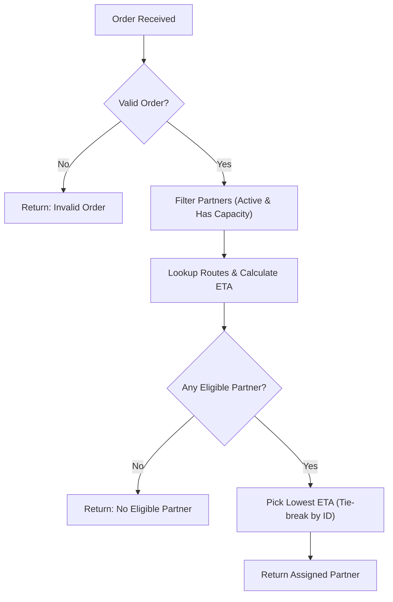

# Architecture Notes

## Project map

Here is how I understand the project files and how they fit together:

- **`service.py`**: Where all the main logic lives:
  - `estimate_eta()`: Does the math for pickup and total delivery time.
  - `assign_order()`: Finds active partners, checks capacity, calculates ETAs, and picks the best one.
  - `process_cancellation()`: Removes cancelled orders and updates workload without double-counting.
- **`models.py`**: Simple helper functions (`new_order`, `new_partner`) that return Python dictionaries.
- **`fixtures.py` & `main.py`**: A small sample order and two partners so we can run `python -m main` and see it work in the terminal.
- **`tests/`**: Pytest files that check basic contract rules, all the boundary cases, and my regression tests (`test_regressions.py`).

---

## Data model

The project doesn't use classes or databases, just normal Python dictionaries:

- **Order**: Has `order_id`, `restaurant_id`, `destination_zone`, and `prep_minutes`.
- **Partner**: Has `partner_id`, `zone`, `active` (`True`/`False`), `capacity` (max orders they can take), `active_order_ids` (current orders), and `workload_minutes`.
- **Travel Map**: A dictionary where the key is a tuple of two zones `(from_zone, to_zone)` and the value is the travel time in minutes.

---

## Data flow

When `assign_order()` is called:

1. **Check Order**: Make sure order ID, restaurant ID, and destination zone exist, and prep time is $\ge 0$.
2. **Filter Partners**: Skip anyone who is inactive (`active != True`) or already full (`len(active_order_ids) >= capacity`).
3. **Check Routes**: For each remaining partner, look up travel to the restaurant (leg 1) and from the restaurant to the customer (leg 2). If either route is missing or negative, skip that partner.
4. **Calculate ETA**:
   - `pickup = now + leg1 + workload`
   - `eta = pickup + prep + leg2`
5. **Select Winner**: Pick the partner with the lowest ETA. If two partners have the same ETA, pick the one whose `partner_id` comes first alphabetically.

---

## Storage design

- Everything is kept in Python's memory while the program runs. There is no SQL database or file saving.
- In `process_cancellation()`, we use `deepcopy()` to make a clean copy of the partner dictionary before editing their active orders and workload.

---

## Diagram

---

## Three improvements suggested

1. **Use simple Python classes instead of dictionaries**: Right now, if you misspell a key like `partner['acitve']`, Python just returns `None` without warning. Basic classes would help catch typos.
2. **Batch order assignment**: Right now the code only assigns one order at a time. It would be cool to support assigning a list of orders in priority order.
3. **Check the travel table once at the start**: Instead of checking whether travel times are negative or strings during every single order lookup, we could validate the travel dictionary once when loading the data.
