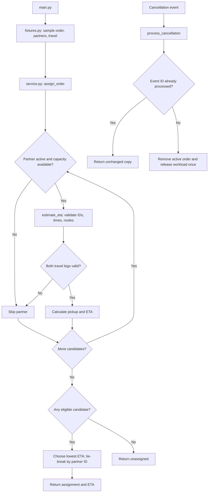

# Architecture Notes

## Project map

- `main.py`: command-line entry point for the offline demonstration.
- `fixtures.py`: builds a small synthetic order, partner list, and travel-time mapping.
- `models.py`: helper functions that create order and partner dictionaries.
- `service.py`: validates records, estimates ETAs, filters eligible partners, assigns an order, and handles cancellation events.
- `data/records.json`: expanded synthetic dataset used for investigation and by a regression test; it is not loaded by the demo entry point.
- `tests/`: visible unit and regression tests.
- `.github/workflows/`: automated test workflow configuration.

## Data model

**Order record**

- `order_id`: non-empty order identifier.
- `restaurant_id`: non-empty restaurant identifier/location used by route lookups.
- `destination_zone`: non-empty customer destination zone.
- `prep_minutes`: finite, non-negative preparation duration.

**Partner record**

- `partner_id`: non-empty partner identifier.
- `zone`: partner's current zone.
- `active`: must be exactly `True` to be considered.
- `capacity`: positive integer maximum active-order count.
- `active_order_ids`: list used to check remaining capacity.
- `workload_minutes`: finite, non-negative remaining workload.
- `minutes_by_order`: workload associated with individual active orders, used during cancellation.
- `processed_cancellation_ids`: event IDs already handled.

**Travel mapping**

Keys are two-item tuples `(from_location, to_location)`; values are finite, non-negative minutes. The JSON dataset stores travel rows, so the regression test converts those rows to the tuple-key mapping expected by the service.

## Data flow

1. `main.py` calls `sample_inputs()` in `fixtures.py`.
2. The fixture uses `new_order()` and `new_partner()` from `models.py` to build sample dictionaries.
3. `assign_order()` in `service.py` skips inactive/full/invalid partners.
4. For each remaining partner, `estimate_eta()` validates IDs, times, travel mapping, and both route legs.
5. The service calculates pickup and delivery ETA, then chooses the smallest ETA; ties use ascending lexicographic partner ID.
6. If no candidate is valid, the service returns an unassigned result.
7. Separately, `process_cancellation()` copies a partner record, ignores a previously processed event ID, and releases an order's workload at most once.

## Storage design

The dispatch calculations operate on in-memory Python dictionaries, lists, and mappings. The demo does not write to a database or persist state between runs. `data/records.json` is a static synthetic dataset for inspection and tests; it is not a live data source. No database, network service, map provider, or GPS integration is part of this assignment.

## Diagram

## Three improvements suggested

These are future ideas only; they are not implemented in this submission.

1. Add an explicit input adapter that validates and converts JSON dataset rows into service-ready order, partner, and tuple-key travel mappings.
2. Add focused tests for malformed cancellation records and numeric overflow in final ETA addition, while preserving the current acceptance behavior.
3. Profile assignment with larger representative datasets before considering indexing or caching; no performance bottleneck has been measured yet.

