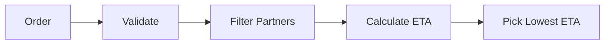

# Architecture Notes

## Project map
- `service.py`: Main logic for calculating ETA, choosing delivery partners, and handling cancellations.
- `models.py`: Helper functions that return basic dictionaries for orders and partners.
- `fixtures.py` & `main.py`: Sample test inputs and a simple runner script.
- `tests/`: Pytest files checking contract rules, edge cases, and regressions.

## Data model
Data is stored using simple Python dictionaries:
- **Order:** `order_id`, `restaurant_id`, `destination_zone`, and `prep_minutes`.
- **Partner:** `partner_id`, `zone`, `active`, `capacity`, `active_order_ids`, and `workload_minutes`.
- **Travel times:** Dictionary mapping `(from_zone, to_zone)` to minutes.

## Data flow
1. Validate that order IDs exist and preparation time is $\ge 0$.
2. Filter for partners who are active (`active=True`) and below capacity.
3. Look up both travel legs and compute ETA:
   - `pickup = now + leg1 + workload`
   - `eta = pickup + prep + leg2`
4. Pick the partner with the lowest ETA (break ties by partner ID alphabetically).

## Storage design
- No external database or files; everything is kept in Python memory.
- Used `deepcopy` in cancellation to avoid mutating partner data directly.

## Diagram

## Three improvements suggested
1. Use simple Python classes instead of dictionaries to avoid typos in keys.
2. Support batch order assignments instead of only handling one order at a time.
3. Check travel times once when loading data rather than on every lookup.
