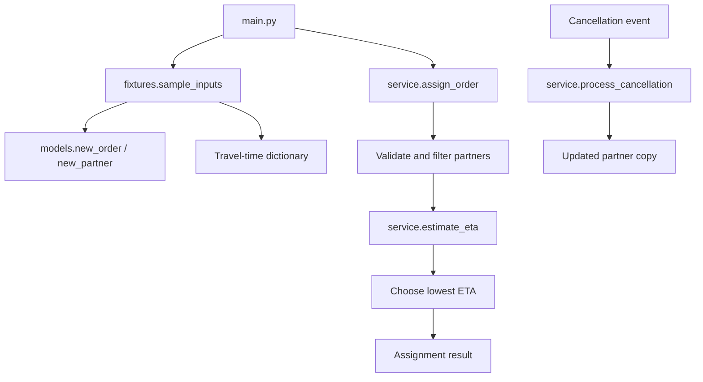

# Architecture Notes

## Project map
- `main.py`: executable entry point; loads sample inputs and prints the assignment result.
- `fixtures.py`: creates a sample order, partners, and travel-time mapping.
- `models.py`: provides dictionary-based constructors for orders and partners.
- `service.py`: contains ETA estimation, partner assignment, and cancellation processing.

## Data model
- Order: dictionary containing `order_id`, `restaurant_id`, `destination_zone`, and `prep_minutes`.
- Partner: dictionary containing `partner_id`, `zone`, `active`, `capacity`, `active_order_ids`, `workload_minutes`, `minutes_by_order`, and `processed_cancellation_ids`.
- Travel data: dictionary keyed by `(origin, destination)` tuples, with travel minutes as values.
- Assignment result: dictionary containing `order_id`, `partner_id`, `pickup_minutes`, `eta_minutes`, and `reason`. An unassigned order uses `partner_id=None` and `eta_minutes=None`.

## Data flow
1. `main.py` calls `sample_inputs()` from `fixtures.py`.
2. `sample_inputs()` creates an order and partner dictionaries using `models.py`, then constructs the travel-time dictionary.
3. `main.py` passes the order, partner list, and travel dictionary to `assign_order()`.
4. `assign_order()` evaluates candidates using `estimate_eta()`, then returns an assignment or an unassigned result.
5. `process_cancellation()` receives a partner dictionary, order ID, and cancellation event ID and returns a copied partner state.

## Storage design
- The supplied starter code uses in-memory Python dictionaries and lists.
- No database, file persistence, or external storage layer is visible in the supplied files.
- `process_cancellation()` uses `deepcopy`, so it returns a modified copy rather than mutating the original partner dictionary.

## Diagram

## Three improvements suggested
1. Add automated tests for validation, capacity, missing travel entries, ETA tie-breaking, and duplicate cancellation events.
2. Define and document a consistent policy for malformed partner state and cancellation workload metadata.
3. Consider typed data models or validation helpers to make the dictionary-based data contract easier to maintain.
